<div align="center">



# run

**Paste the commands. They run in order.**<br>
One shell for the whole paste. Comments stay comments.

<a href="#jack-in"></a>
<a href="#the-paste"></a>
<a href="https://omarchy.org"></a>

<kbd>[jack in](#jack-in)</kbd>&nbsp;
<kbd>[the paste](#the-paste)</kbd>&nbsp;
<kbd>[faq](#faq)</kbd>

</div>

`run` waits on a new line, shows the paste with its line breaks, and runs each command. `#` comments are ignored. Quotes and heredocs keep their text.


## Jack in

```sh
curl -fsSL https://raw.githubusercontent.com/uxeric/run/HEAD/install.sh | bash
```


## The paste

```sh
run
```

Paste ends, and this runs. Ctrl-D runs what you typed.

```text
cd ~/app
git status -sb                # expect "## main", nothing behind
git commit -F- <<'EOF'
Adds the paste runner
EOF
```

The commands share one shell, so `cd` sticks. The first command that exits non-zero stops the run. Close a heredoc. If its closing line is missing, nothing runs.

A newer version asks before it replaces this one. Enter installs it and continues. `n` keeps this version. `run --update` installs without asking.


## FAQ

> [!NOTE]
> **Does the comment run?**<br>
> No. `#` is ignored, including after a command. Text inside quotes and heredocs is kept.

> [!IMPORTANT]
> **What if the heredoc never closes?**<br>
> Nothing runs. Add the closing line and paste again.

<div align="center">
<br>


<sub><code>// the comment is not a command</code></sub>

</div>
